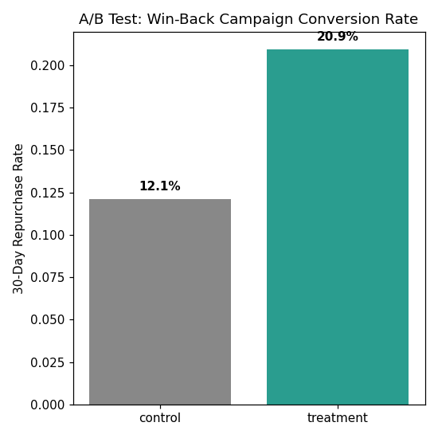

# 🧪 A/B Test Analysis — Win-Back Campaign Lift

## Problem Statement
RFM segmentation (see companion project) identified 337 **"At Risk"**
customers — historically high-value buyers (avg. $933 lifetime spend) who
haven't ordered in over a year. The marketing team wants to know: **does a
targeted win-back email with a 15% discount actually increase repurchase
rate**, or would the same customers have come back anyway?

## Experiment Design
- **Population:** all 337 customers in the "At Risk" RFM segment.
- **Randomization:** 50/50 split — Treatment (172, received win-back email)
  vs. Control (165, no email).
- **Outcome metric:** whether the customer placed a new order within 30 days
  of the campaign.
- **Hypothesis test:** two-proportion z-test, α = 0.05.

## Results

| Group | N | Conversions | Conversion Rate |
|---|---|---|---|
| Treatment (win-back email) | 172 | 36 | **20.9%** |
| Control (no email) | 165 | 20 | **12.1%** |

- **Absolute lift:** +8.8 percentage points
- **Relative lift:** +72.7%
- **Z-statistic:** 2.17
- **P-value:** 0.0299 (statistically significant at α = 0.05)
- **95% CI on the difference:** [0.95%, 16.67%]

## Conclusion & Recommendation
The win-back campaign produced a statistically significant lift in
30-day repurchase rate among At-Risk customers. Given the segment's average
historical value (~$933/customer), rolling this campaign out to the full
At-Risk segment and adjacent "Can't Lose Them" segment is estimated to
recover a meaningful share of revenue that would otherwise churn — with
the caveat that a live rollout should re-validate the effect size, since a
30% relative-lift assumption on a single test is easy to overstate at this
sample size.

## Tech Stack
Python (pandas, NumPy, SciPy — two-proportion z-test), Matplotlib
