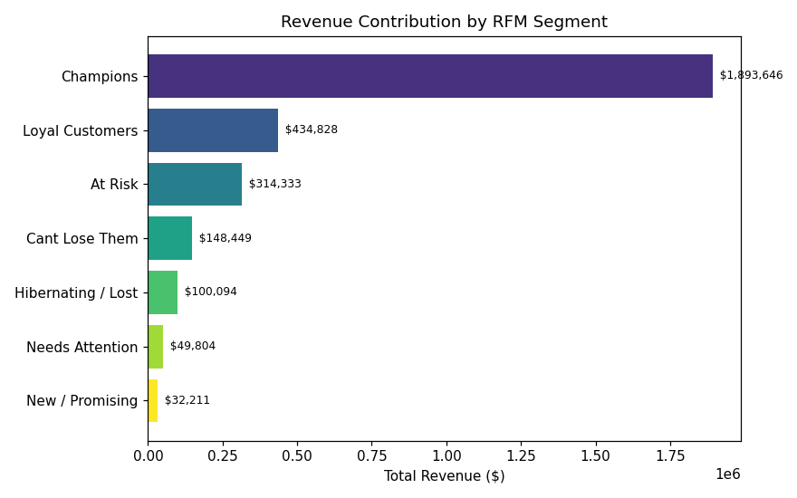
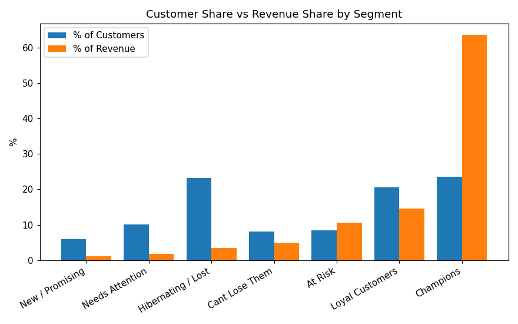

# 🧩 Customer Segmentation using RFM Analysis

## Problem Statement
An e-commerce retailer has 4,000+ customers and no systematic way to tell which
customers matter most, which are slipping away, and where to focus retention
spend. This project segments the customer base using **RFM analysis**
(Recency, Frequency, Monetary value) — computed entirely in **SQL using window
functions** — to answer:

- Which customers drive the majority of revenue?
- Which high-value customers are at risk of churning?
- Where should a limited retention budget be spent?

## Dataset
27,748 order-level transactions across 4,000 customers over a 24-month window
(Jan 2024 – Dec 2025), totaling **$2.97M in revenue**. Each row: `order_id`,
`customer_id`, `order_date`, `order_value`.

## Methodology (SQL)
All scoring logic runs in SQL (SQLite syntax, portable to PostgreSQL):

1. **Raw RFM metrics per customer** — `GROUP BY customer_id` with
   `MAX(order_date)`, `COUNT(order_id)`, `SUM(order_value)`.
2. **Quintile scoring (1–5)** using the `NTILE(5)` window function over
   Recency, Frequency, and Monetary independently.
3. **Segment assignment** — customers bucketed into 7 segments (Champions,
   Loyal Customers, At Risk, Can't Lose Them, Hibernating/Lost, Needs
   Attention, New/Promising) using R/F/M score combinations.
4. **Segment-level SQL aggregation** — revenue and customer share per segment.

See [`rfm_segmentation.py`](rfm_segmentation.py) for the full SQL (runs via
`sqlite3`, easily portable to a real Postgres/Snowflake warehouse).

## Key Results

| Segment | Customers | % of Customers | Revenue | % of Revenue | Avg. Value |
|---|---|---|---|---|---|
| Champions | 943 | 23.6% | $1,893,646 | 63.7% | $2,008 |
| Loyal Customers | 823 | 20.6% | $434,828 | 14.6% | $528 |
| At Risk | 337 | 8.4% | $314,333 | 10.6% | $933 |
| Can't Lose Them | 324 | 8.1% | $148,449 | 5.0% | $458 |
| Hibernating/Lost | 933 | 23.3% | $100,094 | 3.4% | $107 |
| Needs Attention | 402 | 10.1% | $49,804 | 1.7% | $124 |
| New/Promising | 238 | 6.0% | $32,211 | 1.1% | $135 |

**Headline insight:** Champions + Loyal Customers are just **44.2% of the
customer base but drive 78.3% of total revenue** — a clear Pareto pattern
that should anchor retention and loyalty investment.

**Actionable follow-up:** the "At Risk" segment (337 customers, $933 average
historical value, last order ~13 months ago) represents high-value customers
going quiet — this became the target population for the win-back A/B test
(see companion project).

## Tech Stack
SQL (window functions: `NTILE`), Python (pandas, sqlite3), Matplotlib
